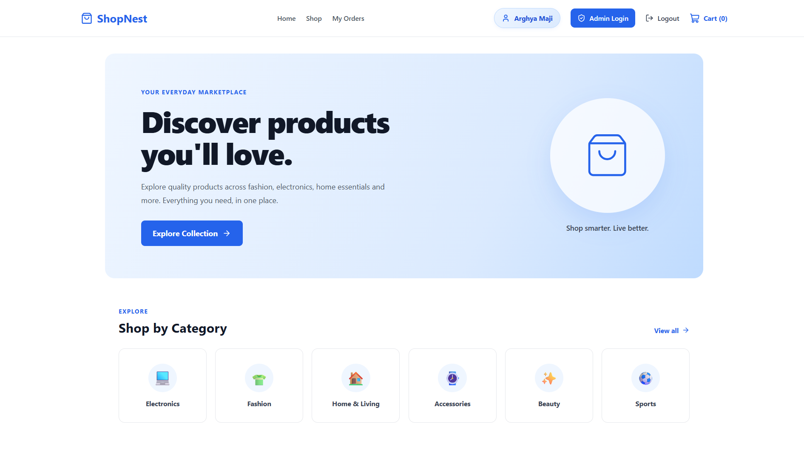
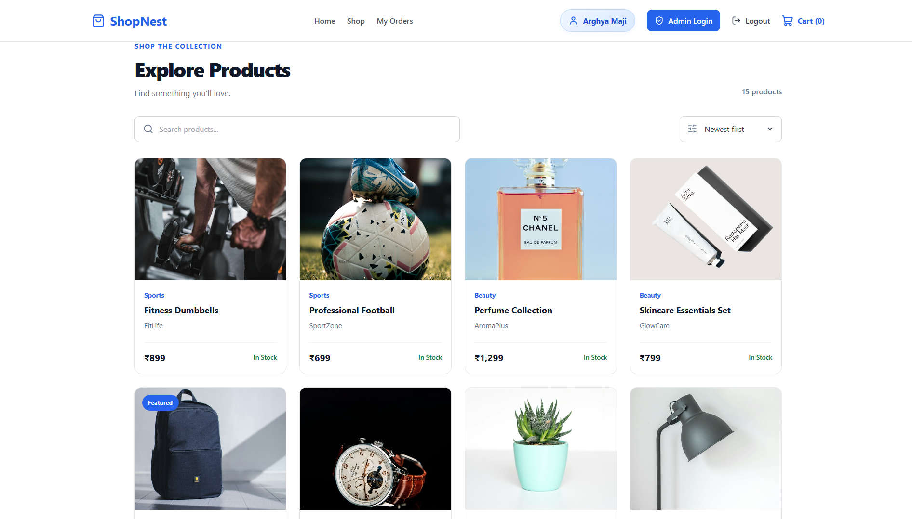
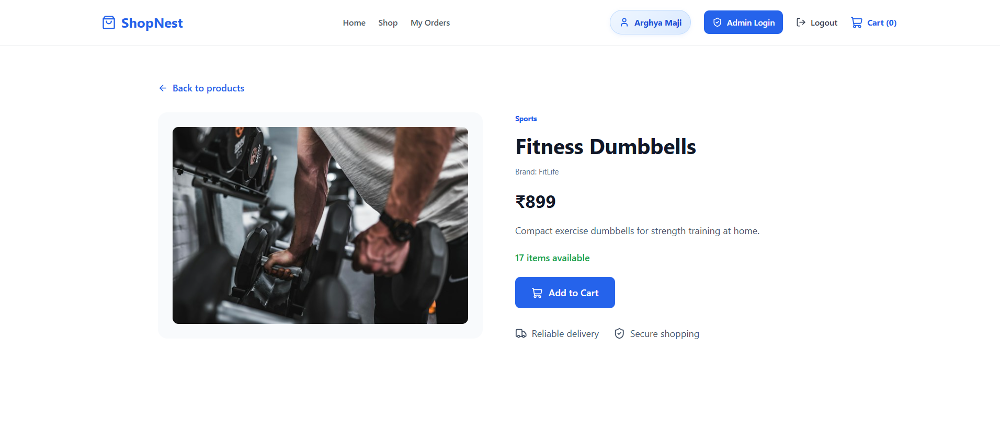
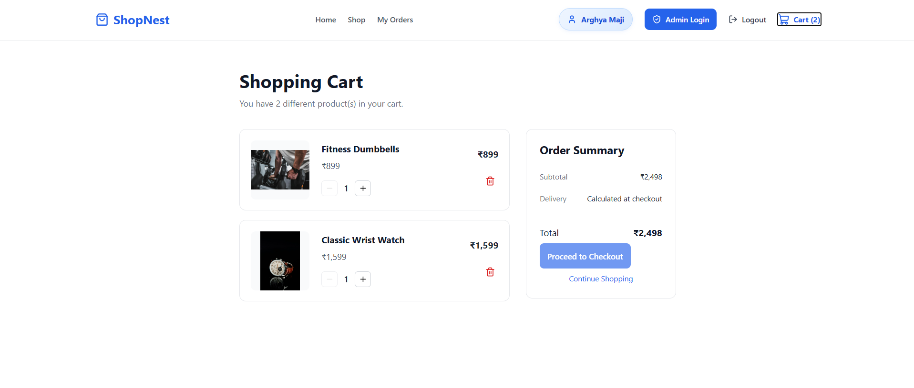
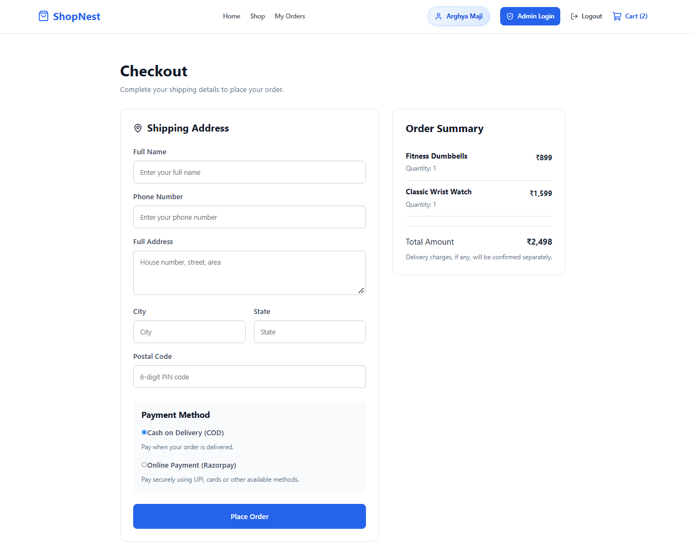
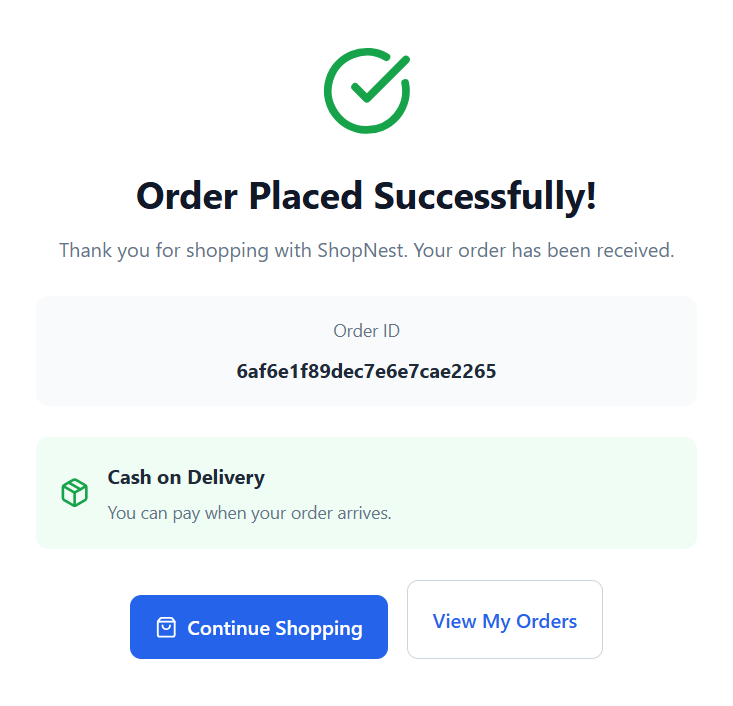
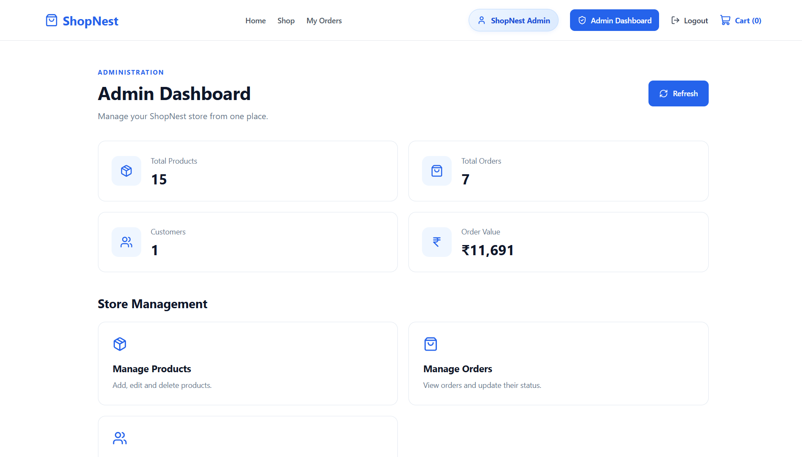
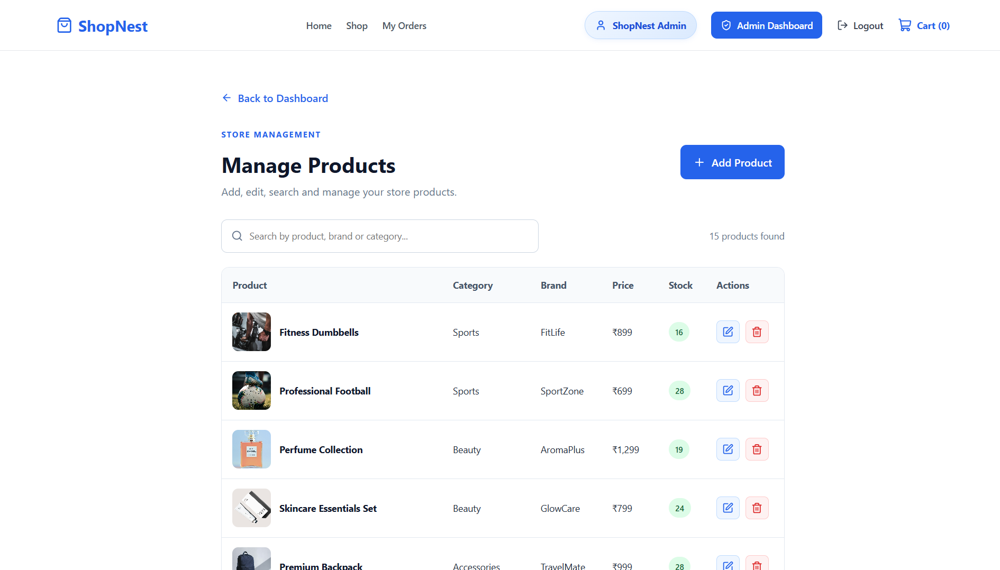
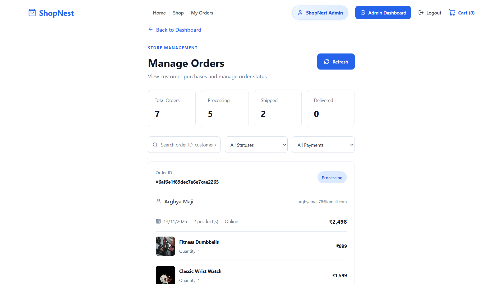
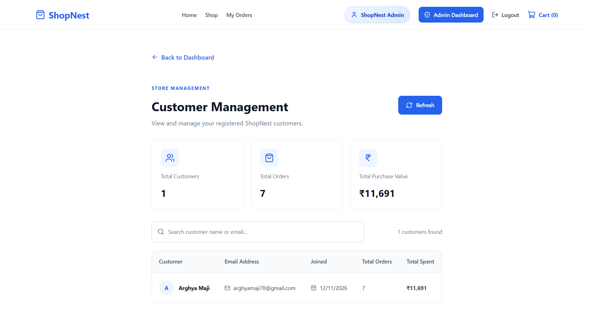

# ShopNest – Online Shopping Store

**ShopNest** is a full-stack e-commerce web application developed as part of the **CodeAlpha Full Stack Development Internship**.

It provides a complete online shopping experience with customer authentication, product browsing, shopping cart management, checkout, online payment integration, and an administrative dashboard.

## Screenshots

### Customer Interface

| Homepage | Product Listing |
|---|---|
|  |  |

| Product Details | Shopping Cart |
|---|---|
|  |  |

| Checkout | Order Success |
|---|---|
|  |  |

### Admin Dashboard

| Admin Dashboard | Manage Products |
|---|---|
|  |  |

| Manage Orders | Manage Customers |
|---|---|
|  |  |

## Features

### Customer Features
- Customer registration and login.
- Browse and search products.
- View product details and stock availability.
- Add products to the shopping cart.
- Update product quantities and remove items.
- Checkout with shipping address.
- Cash on Delivery (COD).
- Razorpay online payment integration.
- Order confirmation and order history.

### Admin Features
- Secure admin authentication.
- Dashboard with store statistics.
- Add, edit, and delete products.
- Manage customer information.
- View and manage customer orders.
- Update order status.
- Monitor order information.

### Responsive Design
- Mobile-friendly interface.
- Tablet and desktop layouts.
- Responsive customer and admin pages.

## Technology Stack

**Frontend**
- React.js
- Vite
- React Router
- Axios
- CSS
- Lucide React

**Backend**
- Node.js
- Express.js
- MongoDB
- Mongoose
- JWT Authentication

**Payment Integration**
- Razorpay Test Mode

## Project Structure

```text
CodeAlpha_EcommerceStore/
├── client/
│   ├── src/
│   └── package.json
├── server/
│   ├── models/
│   ├── routes/
│   ├── controllers/
│   └── package.json
├── screenshots/
├── .gitignore
└── README.md
```

## Installation and Setup

### 1. Clone the Repository

```bash
git clone YOUR_GITHUB_REPOSITORY_URL
cd CodeAlpha_EcommerceStore
```

### 2. Install Frontend Dependencies

```bash
cd client
npm install
```

### 3. Install Backend Dependencies

Open another terminal:

```bash
cd server
npm install
```

### 4. Configure Environment Variables

Create a `.env` file inside the `server` directory.

Configure your MongoDB connection, JWT secret, and Razorpay credentials using the environment variable names already used in your backend.

**Important:** Never upload your `.env` file or expose secret API credentials on GitHub.

### 5. Run the Backend

From the `server` directory, use the start command defined in your `package.json`.

For example:

```bash
npm run dev
```

### 6. Run the Frontend

From the `client` directory:

```bash
npm run dev
```

Open the local Vite URL displayed in your terminal.

## Payment Testing

ShopNest includes Razorpay payment integration. Online transactions can be tested using Razorpay Test Mode credentials and test payment methods.

## Future Improvements

- Product reviews and ratings.
- Wishlist functionality.
- Advanced admin analytics.
- Improved order tracking.
- Production payment configuration.

## Internship Information

**Program:** CodeAlpha Full Stack Development Internship  
**Project:** Online Shopping Store  
**Project Name:** ShopNest

## Author

**Arghya Maji**

GitHub: [Arghya-03](https://github.com/Arghya-03)